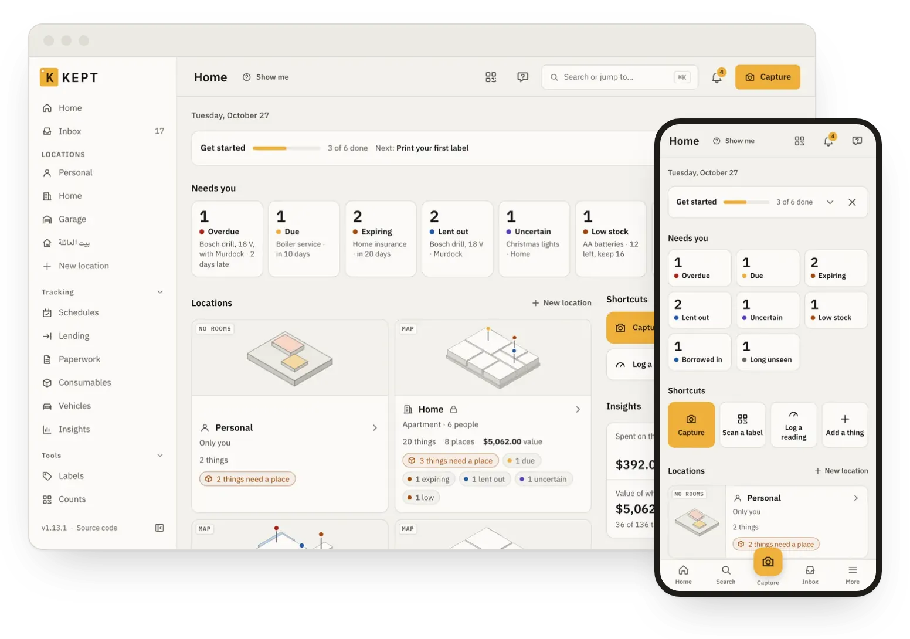
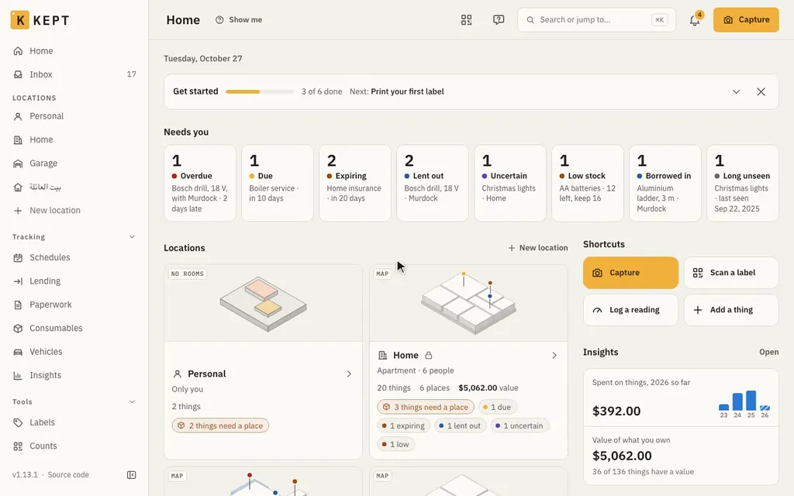
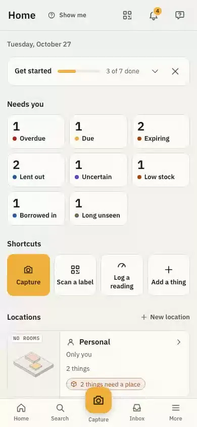
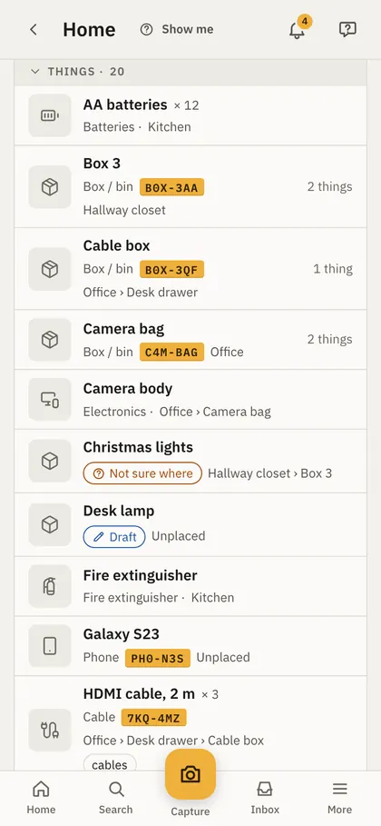
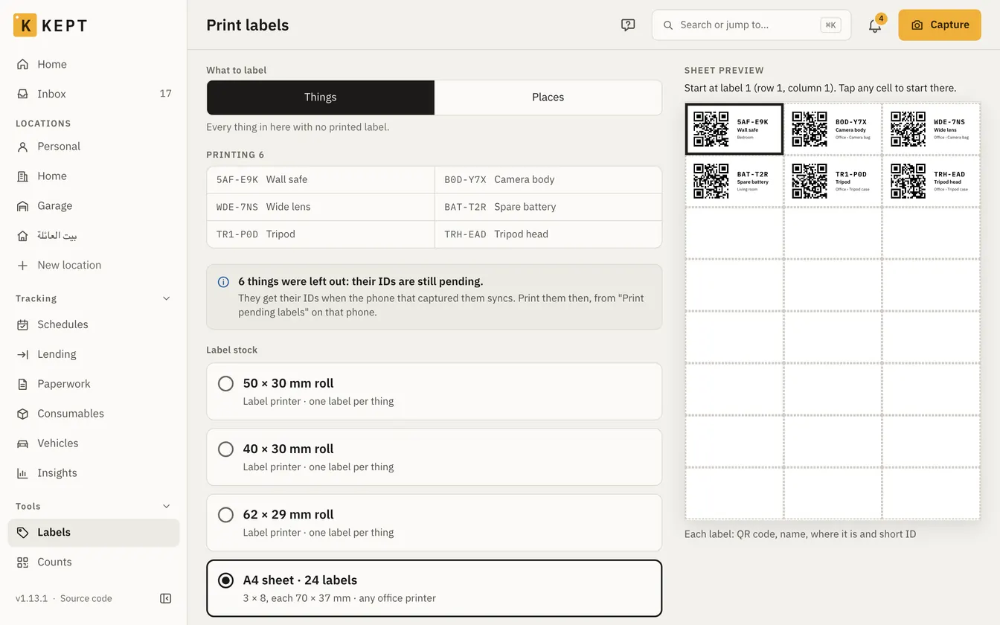

<p align="center">
  <picture>
    <source media="(prefers-color-scheme: dark)" srcset="docs/assets/kept-lockup-dark.svg">
    
  </picture>
</p>

<p align="center">
  A self-hosted, open-source inventory of everything you own and where it is.
</p>

<!--
  One style for every badge: flat-square, the kit's ink-2 (#55524C) label and amber (#F0B03A)
  value (apps/web/src/styles/tokens.css). Release and CI are live (shields.io reads GitHub): CI
  turns red when the ci workflow fails on main. Both read public data, so they render once the
  repository is public. Discord counts the members of the invite's server, live.
-->
<p align="center">
  <a href="https://github.com/keptinventory/kept/releases/latest"></a>
  <a href="https://github.com/keptinventory/kept/actions/workflows/ci.yml"></a>
  <a href="LICENSE"></a>
  <a href="https://keptinventory.info/"></a>
  <a href="https://github.com/orgs/keptinventory/packages/container/package/kept"></a>
  <a href="https://hub.docker.com/r/keptinventory/kept"></a>
  <a href="https://discord.gg/g4WCXPfuNv"></a>
  <a href="CONTRIBUTING.md#sign-the-cla-once"></a>
</p>

<p align="center">
  <picture>
    <source media="(prefers-color-scheme: dark)" srcset="docs/assets/kept-hero-dark.webp">
    
  </picture>
</p>

Homes, garages and storage units; the rooms, shelves and boxes inside them; the things inside
those, with receipts, manuals, warranties and history. Self-hosted, on your own server or homelab.
Nothing leaves it unless you turn it on: no telemetry, the update check off by default, the AI
provider yours to choose.

## Try it

Nothing to install, nothing saved.

- **[Try Kept](https://keptinventory.info/try/kept/):** the whole app, with a sample household.
- **[Try the map](https://keptinventory.info/try/map/):** the 3D map, with a sample home.
- **[Host it](#quick-start-host-it):** Docker Compose or Kubernetes.

## A look around

<p align="center">
  
</p>

- **List:** names first, each with its type; a box says how much is inside; the amber tape only
  on things with a printed label.
- **Map:** each location in 3D: floors, rooms, shelves and boxes, what's inside one tap away.
  Arranged by you, or laid out by Kept. Plan view, balconies and terraces
  ([the map](https://keptinventory.info/users/location-map/)).
- **Graph:** a location's places, boxes and things, in 2D or 3D.

### On a phone

Installs as an app. Capture, scan and search, offline too.

<p align="center">
  
  
  <picture>
    <source media="(prefers-color-scheme: dark)" srcset="apps/docs/src/assets/screens/list-phone-dark.webp">
    
  </picture>
</p>

### Labels

A short ID and a QR code for every box. Label-printer rolls or office-printer sheets; scan one to
open the box.

<p align="center">
  <picture>
    <source media="(prefers-color-scheme: dark)" srcset="apps/docs/src/assets/screens/labels-dark.webp">
    
  </picture>
</p>

## What it does

- **Inventory.** Locations, places, boxes and things, with photos, documents, tags, custom fields,
  quantities, saved views, search, an archive for what you no longer use and a trash you can
  restore from.
- **Capture.** Photograph a thing, a receipt, a label or a whole room, online or offline; your AI
  provider (OpenAI, Anthropic, Google, OpenRouter, Groq, or an OpenAI-compatible server such as
  Ollama) suggests the details and you confirm them. Without one, you type them.
- **Labels and scanning.** Print label sheets with a short ID and a QR code; scan one to open the
  box it is on. Scan sessions count a shelf, pack a box or move a pile in one go.
- **The household.** Shared locations with roles, lending, kits that go out and come back as one,
  stocktakes, schedules, warranties, paperwork and an insurance report; reminders in the app, by
  mail, by push and in a calendar feed.
- **Moving house.** Numbered boxes, a label and a contents sheet for each, tracked in the van,
  unpacked by scanning ([moving](https://keptinventory.info/users/moving/)).
- **Vehicles and machines.** Readings, services, fuel and running costs.
- **AI assistant and MCP server.** Ask in plain words; changes wait for your OK. Claude and other
  AI agents connect at `/mcp` ([how](https://keptinventory.info/users/mcp-clients/)).
- **Backups you can read.** Nightly restic backups to a directory, S3 or SFTP, each with a copy
  that opens in a browser without Kept; imports from Homebox (a past import can be repaired) and
  CSV, full exports.
- **Your own network or HTTPS.** Works over plain http at home; an export with secret values needs
  HTTPS.
- **Five languages:** English, Arabic (right to left), French, German and Italian.

<p align="center">
  
</p>

## Quick start: host it

Docker with Compose v2, on a machine with at least 2 GB of RAM and 2 CPU cores
([what it needs](https://keptinventory.info/install/hardware/)).

```sh
mkdir kept && cd kept
curl -fsSLO https://raw.githubusercontent.com/keptinventory/kept/v1.14.2/compose.yaml
docker compose run --rm init
docker compose up -d
```

1. **`compose.yaml`:** the whole stack in one file; no clone, no passwords to make.
2. **`init`:** asks the address you'll open Kept at (a name such as `http://kept.home.arpa:8080`
   beats an IP address: printed labels carry it), writes `.env` and shows the setup code.
3. **Start:** the database, a one-shot bootstrap that makes the database logins and their
   passwords, the one-shot `migrate`, then Kept on port 8080 (`KEPT_HTTP_PORT` changes it).
4. **First run:** open the address, enter the setup code, create the first account. It becomes
   the instance admin. Then keep the keys off this server:
   `docker compose exec kept kept admin recovery-kit` prints them.

The camera, installing the app, push and location need HTTPS:
`docker compose --profile https up -d` adds Caddy with a certificate for `KEPT_DOMAIN`, from
the Caddyfile in `docker/caddy/` ([HTTPS](https://keptinventory.info/install/https/)). Every step in full:
[the install guide](https://keptinventory.info/install/compose/).

- **Kubernetes:** the Helm chart, `oci://ghcr.io/keptinventory/charts/kept`, signed and published
  with each release ([install on Kubernetes](https://keptinventory.info/install/kubernetes/)).
- **Verify the image:** `cosign verify --key cosign.pub <image>:<version>`, with `cosign.pub` from
  this repository ([verifying a release](https://keptinventory.info/admin/verify-release/)).
- **Backups:** nightly, encrypted, to a directory, S3 or SFTP
  ([backups](https://keptinventory.info/admin/backups/)).

## Works with

<p align="center">
  <a href="https://keptinventory.info/integrations/"></a>
</p>

- **Home Assistant:** the [kept-homeassistant](https://github.com/keptinventory/kept-homeassistant)
  integration, a HACS custom repository ([setup](https://keptinventory.info/users/home-assistant/)).
- **Paperless-ngx:** receipts, manuals and warranty cards linked to things
  ([setup](https://keptinventory.info/users/paperless/)).
- **The rest:** [integrations](https://keptinventory.info/integrations/).

## What's next

- **Next:** [compartments on the 3D map](https://github.com/keptinventory/kept/issues/238)
- **Later:** [mobile and desktop apps](https://github.com/keptinventory/kept/issues/169) ·
  [scan a room into the 3D map](https://github.com/keptinventory/kept/issues/197) ·
  [storage furniture templates](https://github.com/keptinventory/kept/issues/238) ·
  [a Home Assistant app](https://github.com/keptinventory/kept/issues/289)

[Full roadmap →](https://github.com/orgs/keptinventory/projects/1) · 👍 the themes you want most.

## Links

| | |
|---|---|
| Documentation | [keptinventory.info](https://keptinventory.info/) |
| Install | [Docker Compose](https://keptinventory.info/install/compose/), [HTTPS](https://keptinventory.info/install/https/), [Kubernetes](https://keptinventory.info/install/kubernetes/) (Helm chart in [`charts/kept`](charts/kept/)), [configuration](https://keptinventory.info/reference/configuration/) |
| API | [HTTP API reference](https://keptinventory.info/api/), generated from the OpenAPI document |
| MCP | [Connect an AI client](https://keptinventory.info/users/mcp-clients/) |
| Roadmap | [Now, next and later](https://github.com/orgs/keptinventory/projects/1) |
| Questions and ideas | [Discussions](https://github.com/keptinventory/kept/discussions) |
| Chat | [Discord](https://discord.gg/g4WCXPfuNv) |
| Contributing | [CONTRIBUTING.md](CONTRIBUTING.md): a discussion or an issue first for anything larger than a fix; [sign the CLA once](CONTRIBUTING.md#sign-the-cla-once) |
| Security | [SECURITY.md](SECURITY.md): report privately, never in a public issue |
| Changelog | [CHANGELOG.md](CHANGELOG.md) |

## Licence

Kept is free software under the GNU Affero General Public License, version 3
([`LICENSE`](LICENSE)), and every feature ships in it: nothing is held back. If you run a modified
Kept for other people, you must offer them its source. The image carries the third-party notices
of everything inside it, served at `/notices.txt`.

## Star history

<p align="center">
  <a href="https://www.star-history.com/?repos=keptinventory%2Fkept&type=date&logscale=&releases=&legend=bottom-right">
    <picture>
      <source media="(prefers-color-scheme: dark)" srcset="https://api.star-history.com/chart?repos=keptinventory/kept&type=date&theme=dark&legend=bottom-right">
      <source media="(prefers-color-scheme: light)" srcset="https://api.star-history.com/chart?repos=keptinventory/kept&type=date&legend=bottom-right">
      
    </picture>
  </a>
</p>
