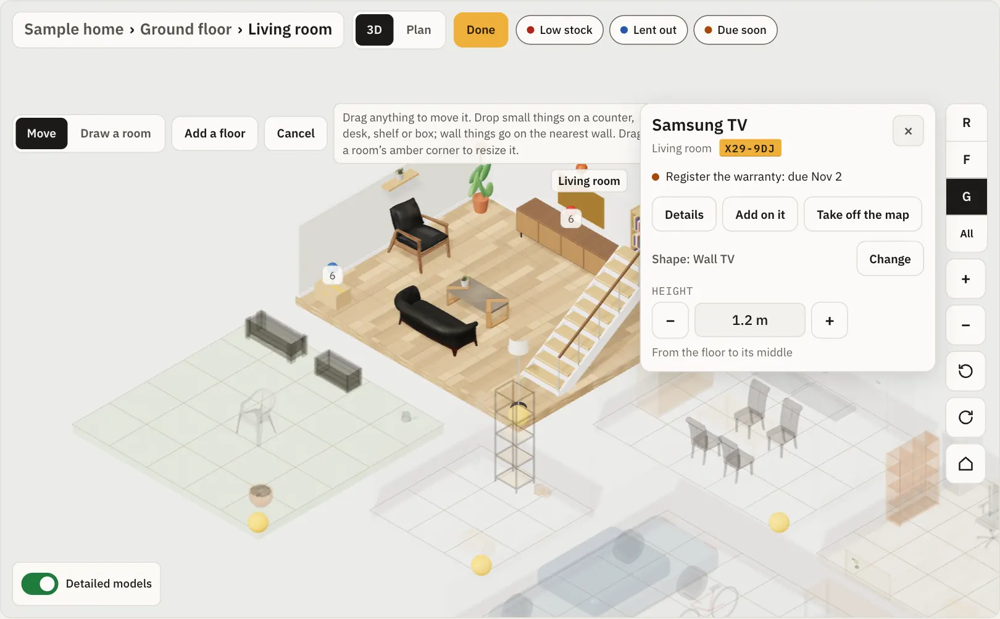

import Clip from '../../../../components/Clip.astro';
import clipMp4 from '../../../../assets/clips/map-add-tv.mp4?url';
import clipPoster from '../../../../assets/clips/map-add-tv-poster.webp?url';
import clipWebm from '../../../../assets/clips/map-add-tv.webm?url';

تحتوي صفحة الموقع على خمسة تخطيطات: **قائمة**، **شبكة**، [**مخطط**](/ar/users/graph/)، **جدول** و**خريطة**. ترسم الخريطة الموقع ثلاثي الأبعاد: كل طابق، وغرفه، والرفوف والخزائن والصناديق بداخله. اضغط على أي شيء لترى ما هو، وأين هو، وما بداخله. تبقى القائمة هي الافتراضي؛ يتذكر Kept اختيارك لكل موقع على كل جهاز. في الخريطة، تتصدر الخريطة وتملأ الشاشة؛ تتبعها أزرار الموقع (طباعة الجرد، طباعة الملصقات والباقي)، **أضف هنا** و**بلا مكان**.

لصفحة طابق أو غرفة **خريطة** أيضًا: نفس الخريطة، مفتوحة على ذلك المكان. يفتح الطابق على ذلك الطابق، وتفتح الغرفة بداخلها مع بطاقتها، ويُحدَّد رف أو خزانة في غرفته. يفتح مكان لا ترسمه الخريطة على غرفته مع ملاحظة. يتذكر Kept الاختيار لكل مكان.

للتجربة قبل تثبيت أي شيء، [جرِّب الخريطة](/ar/try/map/) مع منزل نموذجي في متصفحك.

تحتاج الخريطة إلى اتصال: فهي ليست جزءًا من النسخة غير المتصلة بالهاتف. تُحمَّل فقط عند فتحها، لذا يبقى باقي Kept سريعًا كما كان.

## ما على الخريطة

| على الخريطة | مصدره |
|---|---|
| **طوابق** | أماكن من نوع **طابق** في أعلى الموقع. إن لم يوجد، فالموقع مستوى واحد. |
| **غرف** | كل مكان مباشرة على طابق (أو في الأعلى، عند عدم وجود طوابق)، أيًّا كان نوعه. |
| **رفوف، خزائن، مناطق** | الأماكن مباشرة في غرفة. |
| **صناديق وحاويات أخرى** | الحاويات مباشرة في غرفة. |
| **أي شيء آخر** | شيء تضعه أنت على الخريطة بنفسك، مثل التلفزيون أو السيارة. |

لا تتداخل الأسماء أبدًا ولا تُقطَع: عندما يتلامس اثنان، يبقى اسم الغرفة، ويظهر ما في رف أو صندوق بمجرد التكبير الكافي. الشيء الذي حددته يحتفظ دائمًا باسمه.

يُعدُّ كل شيء آخر: يقول الرف كم شيء عليه، وتذكر بطاقته إياها. لا يضطر أحد لترتيب أي شيء أولًا. الغرف التي لم يرتبها أحد تُرتب جنبًا إلى جنب حسب ترتيب قائمة الأماكن، وما يقف فيها بصفوف؛ **ترتيب** ينقلها إلى حيث هي حقًا. غرفة تسمى "حديقة" أو "شرفة" أو "تراس" تُرسم كواحدة.

تظهر دبابيس ما يحتاج انتباهًا: **مخزون منخفض** (المواد الاستهلاكية)، **مُعار** (الإعارة) و**يحين قريبًا** (الجداول، الضمانات والوثائق). تجلس الدبوس على الرف أو الصندوق الذي يحمل الشيء. تُشغِّل الشرائح في الأعلى كل نوع أو تطفئه.

## التنقل

| | بالماوس | على الهاتف |
|---|---|---|
| تحريك | اسحب | اسحب بإصبع واحد |
| تكبير | عجلة التمرير، أو **+** و**−** | قرص، أو **+** و**−** |
| تدوير | أزرار التدوير | دوِّر بإصبعين، أو زر التدوير |
| افتح غرفة | انقر نقرًا مزدوجًا، أو **افتح** على بطاقتها | انقر نقرًا مزدوجًا، أو **افتح** |
| رجوع | اسم الموقع أو الطابق في الأعلى، أو زر المنزل | نفس الشيء |

تعمل أزرار الطوابق كمصعد: **س**، **١**، **أ** وهكذا، كلٌّ باسم طابقه، و**الكل** يكدِّس كل الطوابق. على الهاتف تجلس في صف واحد في الأسفل مع أزرار التكبير والتدوير، وتتنحى جانبًا بينما بطاقة مفتوحة. **مخطط** ينظر من الأعلى مباشرة، مع الأسماء وما في كل رف. الدرج على الخريطة يأخذك إلى الطابق أعلاه أو أسفله.

تفتح الغرفة مواجهةً لشاشاتها (شاشة، تلفزيون، حاسوب محمول)، فتراها لا ظهورها. دوِّرها لجهة أخرى فتُفتح بتلك الجهة المرة القادمة على هذا الجهاز. جدار كان سيقف بينك وبين غرفة يهبط إلى حافة منخفضة بينما تنظر من تلك الجهة، ويعود قائمًا عندما تدور للخلف؛ ما يعلقه يذهب ويعود معه. يحتفظ المخطط بكل جدار.

## البطاقة

الضغط على شيء يفتح بطاقة مختصرة: اسمه، مكانه، معرّفه القصير (كشريط عنبر عندما يحمل ملصقًا مطبوعًا) وأي شيء يحين. **التفاصيل** تضيف صورته، ملصقه (نفس رمز الاستجابة السريعة الذي يحمله ملصق مطبوع)، حقائقه و**افتح الشيء** أو **افتح المكان**. **داخل** يسرد ما فيه؛ اضغط واحدًا لتراه. بالماوس، التحويم يظهر الاسم، والمعرّف القصير للشيء المملَّص، دون نقرة.

"مكانه" يقرأ من الغرفة في: "مساحة مفتوحة › مكتب ٣" لحاسوب محفوظ في مكتب ٣ وواقف عليه. في نافذة قصيرة أو على هاتف، التفاصيل تمرر داخل البطاقة، و**افتح** يبقى في حافة البطاقة السفلية.

**أثاث بأقسام** ([وحدة تخزين مكعبات، مكتبة، صدر أدراج](/ar/users/locations/#أثاث-بخانات)) يظهر أقسامه: مخططة على واجهته بينما هو محدد، وكشبكة أرقام على بطاقته. اضغط قسمًا على الخريطة أو البطاقة لفتح بطاقته الخاصة: ما فيه، ملصقه و**افتح المكان**.

## ما في الموقع

تحت الخريطة، **ما في** يسرد كل غرفة بما يقف ويرقد فيها. ابحث بالاسم أو المعرّف القصير، اختر طابقًا، أو بدِّل إلى **يحتاج انتباهًا** لكل ما هو منخفض، مُعار أو يحين. ضغطة تظهره على الخريطة. البحث، الطابق والمظهر في العنوان، فيمكنك مشاركتها أو وضع إشارة عليها.

لقارئات الشاشة ولوحات المفاتيح، **الأماكن في هذا الطابق** يسرد غرف الطابق وما يقف فيها، بجانب الخريطة.

## الترتيب

الملاكون، المديرون والأعضاء يمكنهم ترتيب الموقع؛ العارضون يرونه مرتبًا. **ترتيب** يبدأ:

- **نقل**: اسحب أي شيء. الأشياء الصغيرة (حاسوب محمول، مصباح، صندوق) يمكن أن تقف على طاولة، مكتب، رف أو صندوق، وتتحرك معه؛ كاميرا ويب تعلق على حافة شاشة علوية. اسحب شيئًا إلى غرفة أخرى لينتقل في Kept أيضًا. الأشياء الصغيرة تتحرك سنتيمترًا في كل مرة، الأشياء الأخرى ٥ سم والأثاث ١٠ سم؛ على مكتب أو رف تصطف مع حوافه. على حاسوب، أمسك **Alt** (**Option** على ماك) للسحب بحرية.
- **نقل غرفة** بكل ما فيها: أثاث، رفوف، صناديق وما يقف عليها. بالماوس، حدِّد الغرفة، ثم اسحبها. على الهاتف، أمسك طابقها لحظة، ثم اسحب؛ تمرير سريع لا يزال يحرك العرض. مع غرفة محددة، كل مفتاح سهم يحركها مترًا في اتجاه دوران العرض، و**Shift** مع سهم ١٠ سم؛ قارئ الشاشة يسمع أين ذهبت ("نُقلت غرفة النوم يسارًا."). اسحب **زاوية الغرفة العنبرية** لتغيير مقاسها. الغرف تتحرك، تتغير مقاساتها وترسم ١٠ سم في كل مرة، ٥٠ سم على الأقل للجانب، وتبقى على طابقها؛ واحدة ستتداخل مع أخرى تنزلق بجانبها بدلًا من ذلك ("الغرف لا يمكن أن تتداخل.").
- **ارسم غرفة** على أرض فارغة. تصبح مكانًا جديدًا على ذلك الطابق فورًا.
- **من مخطط** يقرأ غرف مخطط طابق (أدناه).
- **أضف طابقًا** يضيف مكانًا من نوع طابق، بغرفة فيه.
- حدِّد غرفة لضبط **نوعها** (غرفة، شرفة، تراس، حديقة)، **أرضيتها** (خشب، بلاط، خرسانة، سطح، عشب) و**عرضها** و**طولها**، أو **ضع شيئًا من تلك الغرفة على الخريطة**. راجع [مقاس الغرفة الحقيقي](#مقاس-الغرفة-الحقيقي).
- حدِّد شيئًا لـ**تدويره**، تغيير **شكله** (أدناه)، **ضعه على** مكتب، رف أو شاشة، **أضف أشياء عليه**، ضبط علو تعليقه على جدار (**الارتفاع**)، أو **أنزله عن الخريطة** (فقط ما وضعته أنت هناك بنفسك).

**مُنجز** يحفظ الترتيب كله دفعة واحدة، والرسالة التالية تعرض **تراجع**. **إلغاء** يعيد الخريطة؛ عند وجود تغيير، يسأل أولًا (**تخلَّص من هذه التغييرات؟**). الغرف والطوابق التي أضفتها تبقى في Kept على أي حال. إذا رتّب شخص آخر نفس الموقع بينما كنت أنت، يقول Kept ذلك ويعرض ترتيبه، بدلًا من الكتابة فوقه. على الهاتف، بطاقة غرفة أو شيء محددة تجلس تحت أدوات الترتيب، فـ**مُنجز** و**إلغاء** يبقيان في متناول اليد بينما هي مفتوحة.

ينتقل الترتيب في تصدير Kept، فانتقال لخادم آخر يحافظ على الخريطة. استيراد Homebox يبدأ من التخطيط التلقائي.

### مقاس الغرفة الحقيقي

يمكن أن يكون للغرفة مقاسها الحقيقي، بالسنتيمتر: شرفة ضيقة ٠٫٨٠ × ٣٫٥٨ م، ممر ١٫١٥ × ٦٫٤٠ م.

- **عند إضافتها:** **أضف هنا → غرفة أو مكان**، في أعلى موقع أو على طابق، بها **المقاس على الخريطة**: **العرض** و**الطول** بالأمتار. اترك كلاهما فارغًا وتحدَّد الخريطة مقاس الغرفة بنفسها. مع مقاس، تذهب الغرفة على الخريطة بذلك المقاس، إلى يمين الغرف المرتبة بالفعل على طابقها، و**تراجع** في الرسالة يعيد الغرفة ومكانها على الخريطة معًا.
- **أثناء الترتيب:** حدِّد الغرفة واكتب **عرضها** و**طولها**، أو قدِّمهما سنتيمترًا بسنتيمتر بـ**−**، **+** أو مفاتيح الأسهم. زاوية الغرفة تبقى حيث هي، وما يقف فيها يبقى بالداخل.
- **العرض** يسير من اليسار لليمين في مظهر المخطط، **الطول** من الأعلى للأسفل. أي علامة عشرية تعمل في أي لغة: ٠٫٨٠ أو ٠,٨٠.
- الغرفة **٥٠ سم على الأقل** و١٠٠ م على الأكثر للجانب. مقاس لا تستطيع أخذه، أو سيدخل في غرفة أخرى، يبقى في الحقل ويوضح السبب؛ الغرفة تحتفظ بمقاسها.
- بطاقة الغرفة تقول مقاسها (**٠٫٨ × ٣٫٥٨ م**)، ومظهر المخطط يكتبه تحت اسم الغرفة.
- **تطبيقات الذكاء الاصطناعي والمساعد** يضيفان غرفة بمقاسها بنفس الطريقة: `create_place` تأخذ `width_cm` و`length_cm` ([تطبيقات الذكاء الاصطناعي](/ar/users/mcp-clients/)).

سحب الزاوية العنبرية لا يزال ١٠ سم في كل مرة؛ مقاس كتبته يبقى كما هو حتى تسحب الزاوية أبعد من ذلك.

## ضع أشياء على الخريطة

الرفوف، الخزائن، المناطق والصناديق الواقفة مباشرة في غرفة موجودة على الخريطة بالفعل. أي شيء آخر، مثل التلفزيون، مكتب أو سيارة، يكون على الخريطة بمجرد وضعك إياه هناك. الملاكون، المديرون والأعضاء يمكنهم فعل ذلك.

### في غرفة لديك بالفعل

1. افتح الموقع واختر **خريطة**.
2. حدِّد الغرفة: اضغط طابقها، أو اضغطها في **ما في** تحت الخريطة. للعمل عن قرب، **افتح** على بطاقتها يدخل الغرفة.
3. اضغط **ترتيب**. بطاقة الغرفة الآن بها **ضع على الخريطة**، تسرد الأشياء الطليقة في الغرفة التي ليست على الخريطة بعد. ما في صندوق، خزانة أو على رف على الخريطة غير مسرد: يذهب حيث يذهب صندوقه.
4. اكتب جزءًا من الاسم أو المعرّف القصير في **ابحث عن شيء في** الغرفة، ثم اضغط الشيء. يظهر في منتصف الغرفة، محددًا.
5. بطاقته تقول أي شكل حصل عليه ولم: **شكل: تلفزيون، من نوعه** أو **من اسمه**. عندما لا يكون Kept متأكدًا، تقول البطاقة **تخمين** وتظهر **اختر شكلًا**.
6. **تغيير** (أو **اختر شكلًا**) يفتح الأشكال. **مقترح** يأتي أولًا، ثم كل شكل في مجموعته (أثاث، تخزين، على الحائط، إلكترونيات، مطبخ وغسيل، أدوات، نباتات وخارجي، مركبات، سلالم ومناطق)، كلٌّ بصورة. **ابحث عن شكل** يبحث في الأسماء وكلماتها الأخرى بأي من لغات Kept: "fridge"، "Kühlschrank" و"ثلاجة" كلها تجد الثلاجة. بينما تكتب، تظهر التطابقات فقط، والأشكال التي يبدأ اسمها أو كلمتها بما كتبت تأتي أولًا: "ca" يجد Car، Camera وWebcam قبل Tool cart. كلمات بلغتك والإنجليزية تطابق من بدايتها؛ كلمة بلغة أخرى تطابق بمجرد كتابتها كلها. امسح البحث لترى المقترح والمجموعات مجددًا. على الهاتف الأشكال تبقى فوق لوحة المفاتيح وتمرر. اضغط شكلًا لاستخدامه. كل شكل، مع مقاسه وكلماته، في [مكتبة الأشكال](/ar/users/map-shapes/)؛ **ينقصك شكل؟ اطلبه** تحت الأشكال يفتح نموذج GitHub لطلب واحد.
شكلان يأخذان مقاسهما منك: رف **وحدة تخزين مكعبات** له **مكعبات بالعرض** و**مكعبات بالارتفاع** على بطاقته (٢ × ٢ في البداية؛ **اقلبه على جانبه** يضجع ١ × ٤ كـ ٤ × ١)، و**مكتبة طويلة** لها **العرض**، **العمق** و**الارتفاع** بالسنتيمترات و**عدد الرفوف** (٨٠ × ٢٨ × ٢٠٢ سم مع ٦ في البداية). ترسم الخريطة كل مكعب وكل رف.
7. اسحب الشيء حيث يقف. الأشياء الصغيرة يمكن أن تقف على مكتب، طاولة، رف أو صندوق. **تدوير** يدوره ربع دورة.
8. اضغط **مُنجز**. الرسالة تعرض **تراجع**. **إلغاء** قبل مُنجز يرمي الجلسة كلها، بعد سؤال.

<Clip
  webm={clipWebm}
  mp4={clipMp4}
  poster={clipPoster}
  width={960}
  height={698}
  label="وضع تلفزيون على الخريطة في الأسرة النموذجية: ترتيب، غرفة المعيشة، ضع على الخريطة، تلفزيون سامسونج، بطاقته تقول شكل: تلفزيون، من نوعه، منتقي الأشكال مع المقترح أولًا وبحث عن تلفزيون، ثم سحب نحو الجدار ومُنجز."
  caption="وضع التلفزيون على الخريطة في الأسرة النموذجية في جرِّب Kept. البطاقة تقول الشكل جاء من نوعه؛ المنتقي يظهر المقترح أولًا، وبحث عن تلفزيون يجده."
/>

### ضع أشياء صغيرة على مكتب، رف أو شاشة

كاميرا ويب عرضها بضع بكسلات عند تكبير الغرفة، لذا لا تضطر لسحبها. في **ترتيب**:

1. حدِّد الشيء الصغير، مثل كاميرا الويب، واضغط **ضع على…**. يسرد ما في نفس الغرفة يمكنه حمله، كلٌّ بصورة شكله: "مكتب"، "شاشة"، "رف ٢".
2. اضغط واحدًا. الشيء ينقر عليه، في المنتصف أو بجانب ما هناك بالفعل.
3. للجهة الأخرى، حدِّد المكتب أو الشاشة واضغط **أضف عليه**. اختر واحدًا أو عدة من أشياء الغرفة الصغيرة التي ليست على شيء بعد، ثم **ضع ٣ عليه**. تذهب جنبًا إلى جنب، لا فوق بعضها.
أشياء الغرفة الصغيرة الطليقة غير الموجودة على الخريطة بعد هناك أيضًا، تحت **ليس على الخريطة بعد**، مع الشكل الذي سيحصل عليه كلٌّ: اختيار واحد يضعه على الخريطة وعلى المكتب دفعة واحدة.
4. **أنزله**، في **ضع على…**، يعيد الشيء إلى أرضية الغرفة بجانب حامله.

ما يحمل ما:

- **فوق**: مكتب، طاولة، طاولة علوية، رف، حامل تلفزيون أو صندوق يحمل أشياء صغيرة.
- **على الحافة العلوية**: شاشة، تلفزيون أو شاشة حاسوب محمول يحمل كاميرا ويب، مكبر ذكي أو ضوء: أشياء صغيرة حتى ١٢ سم عمقًا و٢٠ سم ارتفاعًا، لا أعرض من الشاشة.
- **على ذراع**: **ذراع شاشة** يقف على مكتب ويحمل شاشة واحدة، **ذراع شاشتين** اثنتين، جنبًا إلى جنب ومرفوعتين عن المكتب. **أضف عليه** على ذراع يسرد شاشات الغرفة ويقول متى امتلأ الذراع. كاميرا ويب على شاشة على ذراع لا تزال تعمل. الذراع يثبت على حافة المكتب الخلفية، الجهة البعيدة عن الكرسي: في المنتصف، أو في زاوية خلفية عندما المنتصف مشغول. شاشاته تعلو المكتب أمامه، وسحبه يزلقه على طول الخلف.

- **من خطافات**: **جدار أدوات** (لوح مثقب) أو **خطافات** يحمل أدوات، حقائب وأشياء صغيرة أخرى، معلقة في صف أمامها (أدناه).

نقل حامل ينقل ما عليه: حرِّك المكتب وذراعه، الشاشتان وكاميرا الويب تذهبان معه. دوِّر المكتب ويدوران معه. هذا للخريطة فقط: وضع كاميرا ويب على شاشة يغير مكان وقوفها على الخريطة، لا مكانها في Kept. **مُنجز** يحفظها مع باقي الجلسة، و**تراجع** يعيدها. العارضون يرونها، ولا يستطيعون تغييرها.

### علِّق أشياء على جدار

تلفزيون على حامل، رف، ساعة: في **ترتيب**، اسحب واحدًا قرب جدار فينقلب مسطحًا عليه، مواجهًا للداخل.

1. أعطِ الشيء شكل جدار: **تلفزيون حائط**، **رف حائط**، **خزانة حائط**، **صورة أو مرآة**، **ساعة حائط**، **خطافات** أو **جدار أدوات**، تحت **على الحائط** في الأشكال. شيء يسمى "تلفزيون حائط"، "رف عائم"، "مرآة" أو "لوح مثقب" يحصل على واحد بذاته.
2. يذهب على أقرب جدار. اسحبه على طول الجدار، أو إلى جدار آخر؛ يتحرك بخطوات، مثل كل شيء، وAlt (Option) يسحبه بحرية.
3. بطاقته بها **الارتفاع**: كم علو وسطه عن الأرضية. كل شكل يبدأ في مكان معقول: تلفزيون على مستوى العين (١٫٢ م)، رف أو صورة على ١٫٥ م، ساعة على ١٫٨ م. **−** و **+** تحركانه ٥ سم، ومفاتيح الأسهم كذلك؛ أو اكتب ارتفاعًا. يبقى بين الأرضية و٣ م.
4. أشياء على جدار لا تدور: تواجه الداخل دائمًا.

يرف حائط يحمل أشياء صغيرة فوقه، مثل أي رف: نبتة صغيرة، مكبر، إطار صورة. جدار أدوات أو خطافات يحمل أدوات وحقائب، معلقة أمامها. استخدم **ضع على…** على الشيء الصغير، أو **أضف عليه** على الرف، جدار الأدوات أو الخطافات، كما أعلاه؛ سحب شيء صغير عليهما يعمل أيضًا.

أشياء تقف تحت رف حائط أو تلفزيون تبقى حيث هي: التلفزيون يعلو حامل التلفزيون، وكلاهما مرسوم. في **مخطط**، أشياء على جدار شريط رفيع على طول جدارها، فلا تخفي ما تحتها؛ ما على رف حائط أو خطافات يُسمَّى على ملصقه بمجرد التكبير.

جدران غرفة تقف حيث شيء معلّق عليها، طويلة بما يكفي له. دوِّر العرض حتى يقف جدار بينك وبين الغرفة، فيهبط لحافة مع ما عليه؛ دوِّر للخلف وهم هناك مجددًا. غرفة تفتح مواجهة تلفزيونها، على الحائط أو لا.

هذا للخريطة فقط: تعليق شيء يغير مكانه على الخريطة، لا مكانه في Kept. **مُنجز** يحفظه مع باقي الجلسة، و**تراجع** يعيده. الارتفاع ينتقل في تصدير Kept مع باقي الترتيب. العارضون يرون أين تعلق الأشياء، ولا يغيرونها.

### كيف يختار Kept الشكل

- **من النوع أولًا.** شيء نوعه تلفزيون، سيارة، دراجة، دراجة نارية أو صندوق يحصل على ذلك الشكل فورًا. نوع يضيق فقط (إلكترونيات، جهاز، أداة) يضع الأشكال المحتملة أولًا في **مقترح** ويترك الاختيار لك. نوع صنعته أنت يُحسب باسمه: نوع يسمى "Television" يعمل كنوع التلفزيون.
- **ثم الاسم**، كلمة كلمة، بكل لغات Kept، مع كلمات شائعة أخرى ("couch"، "telly"، "Kühlschrank"، "تلفزيون"). اسم يشير لشكل واحد ("Samsung TV") يحصل عليه بذاته؛ اسم يمكن أن يكون اثنين ("Screen": تلفزيون أو شاشة) يكون تخمينًا.
- **إلكترونيات يومية لها أشكالها الخاصة**، بأحجامها الحقيقية: كاميرا ويب، كاميرا، مكبر مكتب، مكبر محمول، مكبر طويل، بومبوكس، مكبر ذكي، سوندبار، سماعات رأس، هيدست، سماعات أذن، لوحة مفاتيح، فأرة، حاسوب مكتبي، حاسوب محمول، شاشة، ذراع شاشة، ذراع شاشتين، راوتر، طابعة، وحدة ألعاب، يد تحكم، هاتف، جهاز لوحي، شريط طاقة، قرص خارجي. شيء اسمه "HD webcam" يحصل على كاميرا ويب بذاته، "AirPods Pro" سماعات أذن، "JBL Flip 6" مكبر محمول و"Ergotron LX" ذراع شاشة. "Speaker" مجردًا يمكن أن يكون أي حجم، فيقترح Kept كل مكبر ويتركك تختار.
- **معدات مختبر منزلي أيضًا**: أرفف خوادم على الحائط (٦U، ١٢U) وعلى الأرض (٢٤U، ٤٢U)، التي تحمل العتاد بداخلها كخزانة، وحاسوب صغير، NAS، Raspberry Pi أو SBC، مفتاح شبكة، لوحة وصل وUPS. "Intel NUC" يحصل على حاسوب صغير، "Synology DS923+" على NAS، "مفتاح ٨ منافذ" على مفتاح شبكة و"رف حائط ١٢U" على رف حائط ١٢U. "Server rack" مجردًا يمكن أن يكون أي حجم، فيقترح Kept كل رف ويتركك تختار؛ "Rack" مجردًا يبقى رفًا.
- **ملحقات تكون تخمينًا.** "حافظة هاتف"، "ريموت تلفزيون" أو "حامل حاسوب" تسمي ما هو له، لا ما هو، فيقترح Kept أشكالًا ويتركك تختار.
- **لا شيء يناسب؟** أشياء بلا شكل خاص، مثل ثيرموستات، محور أو شاحن، يُقترح **جهاز صغير**، بحجم أداة. أي شيء آخر يبدأ كـ**شيء صغير**.
- **أثاث بأقسام** بلا شكل خاص يُرسم من شبكته كما يقف: وحدة تخزين مكعبات بمكعباتها، مكتبة برفوفها، صدر أدراج بأدراجه.
- **اختيارك يبقى.** Kept لا يغيِّر أبدًا شكلًا اختاره أحد، والأشياء الموجودة على الخريطة تحتفظ بأشكالها.

### في موقع بلا غرف بعد

مكتب أو وحدة تخزين غالبًا تبدأ بكل شيء في **بلا مكان** بلا غرف. خريطته تقول **لا غرف على الخريطة بعد**، مع **ابدأ من مخطط طابق** (القسم التالي) و**ترتيب**. لرسم الغرف بنفسك:

1. افتح الموقع، اختر **خريطة** واضغط **ترتيب**.
2. اختر **ارسم غرفة** واسحب على الأرض الفارغة. الغرفة تصبح مكانًا جديدًا في Kept فورًا، تسمى غرفة ١؛ أعِد تسميتها من **افتح المكان** على بطاقتها.
3. اضغط **مُنجز**.
4. أعطِ الأشياء مكانًا في تلك الغرفة. في الموقع، **رتّبها** يمرر على بلا مكان شيئًا شيئًا مع منتقي مكان؛ أو افتح شيئًا واستخدم **الإجراءات → نقل**.
5. عاود على الخريطة، ضعهم عليها كما أعلاه: **ترتيب**، الغرفة، **ضع على الخريطة**.

### ابدأ من مخطط طابق

مخطط طابق يُظهر بالفعل غرف منزل، أسماءها ومقاساتها: ورقة وسيط عقاري، PDF بنّاء، لقطة إعلان، صورة رسم. يستطيع Kept قراءته وصياغة الغرف لك لتتحقق. لا يُضاف شيء حتى تقول ذلك.

الملاك، المديرون والأعضاء يمكنهم بدء واحد، حيث التقاط الذكاء الاصطناعي مفعل ومزود يقرأ الصور مضبوط ([مزودو الذكاء الاصطناعي](/ar/users/ai-providers/)). وإلا تقول الخريطة السبب، بنفس كلمات وضع التقاط للغرفة، وتعرض **ترتيب** وحده.

1. على خريطة فارغة اضغط **ابدأ من مخطط طابق**؛ على أي خريطة، **ترتيب → من مخطط**.
2. **اختر ملفًا** (صورة JPEG، PNG، WebP، HEIC أو GIF، أو PDF) أو **التقط صورة** لمخطط ورقي. **تدوير** ربع دورة في كل مرة إذا كان جانبيًا. من PDF، تُقرأ الصفحة الأولى فقط.
3. الورقة تقول تقريبًا كم رمزًا (token) يمكن أن تأخذ القراءة، وأي مزود يقرأها. اضغط **اقرأ المخطط**.
4. الخريطة تقول **يُقرأ المخطط…**. يمكنك المغادرة: المخطط ينتظر على الخريطة، وأي عضو يرى **مخطط طابق جاهز للتحقق** عندما يُقرأ. اضغط **راجعه**.

**ما يُرسل، وما يُحفظ.** يرسل Kept نسخة واحدة من المخطط لمزودك، مُعاد ترميزها دون بيانات موقعه أو كاميرته (لـPDF، صفحته الأولى مرسومة كصورة، مع نص تلك الصفحة)، ولا شيء من Kept نفسه: لا موقع، ولا أسماء غرف أو طوابق. الرفع يبقى مع المخطط بينما تتحقق، يراه الأعضاء ويرتفع فقط، ويُحذف عند إضافة الغرف أو التخلص من المخطط، ما لم تختر **احتفظ بالمخطط مع** الموقع، فيحتفظ به كأحد وثائق الموقع. مخطط لا يكمله أحد يُرمى بعد ٣٠ يومًا.

**التحقق منه.** تتحول الخريطة إلى **مخطط** وتظهر غرف المخطط كخطوط **بنفسجية متقطعة**: متقطعة تعني غير مضافة بعد، بنفسجية تعني الذكاء الاصطناعي قرأها. مع **أظهر المخطط** مشغلًا، المخطط نفسه يرقد تحتها، فترى هل كل خط يجلس على الغرفة التي يسميها. الغرف الموجودة على الخريطة تقف ثابتة بينما تتحقق. اللوحة، **غرف من المخطط**، تسرد كل غرفة مع:

- مفتاح لإضافتها أو استبعادها؛
- **اسمها** كما طُبعت (غرفة بلا ملصق تسمى غرفة ١، غرفة ٢ وهكذا)، يمكن تغييرها؛
- **مقاسها**، للعشرة سنتيمترات، و**نوعها** (غرفة، شرفة، تراس، حديقة)؛
- ملاحظة واحدة على الأكثر، مثل **المخطط يقول ٤٫٠٠ × ٨٫٤٠ م.** (اضغط لاستخدام المقاس المطبوع)، **ليست مستطيلًا: رُسِمت كأكبر جزء فيها.**، **أقل من ٥٠ سم: صغيرة جدًا للخريطة.**، **موجودة بالفعل على الخريطة.** أو **تستخدم مطبخك**، عندما كانت غرفة بذلك الاسم في Kept لكن ليست على الخريطة بعد (**أنشئ غرفة جديدة** تنشئ واحدة بدلًا منها).

لكل طابق من طوابق المخطط **منتقي طابق**: واحد من طوابقك، أو طابق جديد يُصنع عند إضافة الغرف. اسحب غرفة متقطعة لتحريكها، أو زاويتها العنبرية لتغيير مقاسها؛ مفاتيح الأسهم تحرك محددة مترًا و**Shift** مع سهم ١٠ سم. **أدر الغرف** يدير جميعها ربع دورة، لمخطط مرسوم جانبيًا.

**المقياس.** السطر تحت عنوان اللوحة يقول من أين جاءت المقاسات: المقاسات المطبوعة على المخطط (وكم منها يتفق)، مقياسه، أبوابه (مؤخوذة بعرض ٨٠ سم)، أو لا شيء على الإطلاق، عندما **هذه تخمين**. إذا بدت المقاسات خاطئة، اضغط **حدِّد مقاس غرفة**، اكتب عرض وعمق غرفة حقيقية، و**أعد القياس**: كل الغرف تُعاد رسمًا منه.

**إضافتهم.** **أضف ٥ غرف** (عدد الغرف المفعّلة) تصنع الغرف، وأي طوابق جديدة، كأماكن عادية، وتضعها على الخريطة بجانب ما كان هناك. الرسالة تعرض **تراجع**، الذي ينزلها كلها عن الخريطة ويضع الغرف التي صنعها في المهملات، طالما لم يُوضع فيها شيء ولم تُعاد تسميتها أو تُحرَّك منذ ذلك. التاريخ سطر واحد: **أضيفت ٥ غرف من مخطط طابق**. **تخلَّص** يرمي المخطط؛ لا يُضاف شيء.

مدى جودة قراءة نموذج لمخطط يعتمد على المخطط والنموذج: تحقَّق من كل غرفة مقابل المخطط قبل الإضافة. الجدران، الأبواب والنوافذ لا تُرسم، وغرفة ليست مستطيلة تصبح أكبر مستطيل فيها.

### ما يعنيه بلا مكان هنا

**بلا مكان** يحمل الأشياء التي ليس لها مكان بعد. هي في لا غرفة، لذا ليست على الخريطة و**ضع على الخريطة** لا تسردها. أعطِ شيئًا مكانًا في غرفة أولًا؛ يظهر بعدها في قائمة تلك الغرفة.

## نماذج مفصّلة

أثاث، نباتات ووحدات تكييف خارجية مرسومة بنماذج مجانية من
[Poly Haven](https://polyhaven.com) (CC0)، مصغرة للهواتف: نحو ١٥٠ كيلوبايت لكلٍّ على الأكثر، نحو ١٫٥ ميجابايت لجميعها، وطابق العرض فقط يحمل نماذجه. كل شيء آخر يرسمه Kept بنفسه. أطفئ **نماذج مفصّلة** تحت الخريطة ولا يُحمل شيء على الإطلاق؛ يتذكر Kept ذلك على هذا الجهاز.

إذا لم يستطع المتصفح رسم ثلاثي الأبعاد (هاتف قديم، أو رسوميات مطفأة)، تقول الخريطة ذلك والقائمة تحتها لا تزال بكل شيء.
